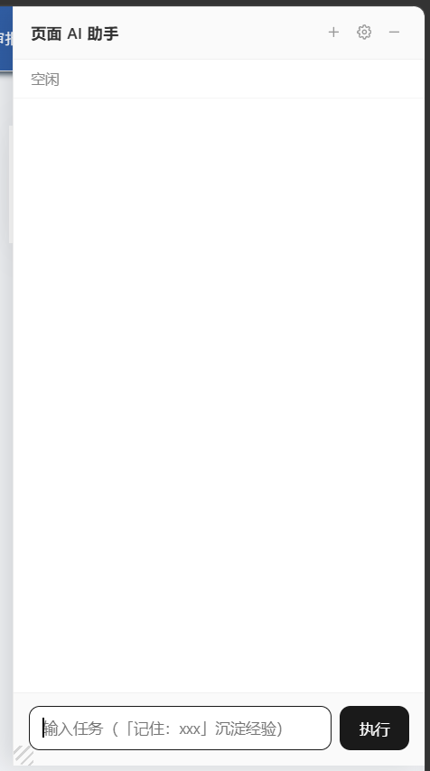

# dsh-browser-relay



DSH 与浏览器之间的通信桥（cordis 插件，零第三方依赖）。浏览器扩展面板提交的每个任务都经 relay 在 DSH 里创建**真实会话**（`~/.dsh/sessions`，dsh web UI 会话列表可见、可追问），由 DSH agent 接管执行；页面操作通过 relay 注册的 `browser_*` 工具桥接回扩展（命令入队 → 扩展长轮询取走 → PageController 执行 → 回传）。模型与网关沿用 DSH 自身配置，relay 不碰 LLM。鉴权统一 relay token，扩展 zip 下载时自动写入本机口令（零配置）。

## 用户安装（无需 git / 无需 node / 不碰任何源码目录）

前提：本机已安装并登录 DSH（`dsh` 命令可用）。

```bash
# ① 安装 relay（按 DSH 原生插件方式；包内自带挂载声明，add 时自动登记，无需手改任何配置）
dsh plugin --profile web add git+<插件仓库地址>

# ② 启动 DSH（relay 随之启动，并自动生成本机口令）
dsh web
```

```text
③ 浏览器打开安装向导：http://127.0.0.1:9916/
   · 下载 dsh-browser-extension.zip 并解压到任意固定目录（口令与端点已自动写入，加载即用，无需任何配置）
   · edge://extensions 开「开发人员模式」→「加载解压缩的扩展」→ 选解压目录
   · 点浏览器工具栏「页面 AI 助手」图标即可使用
```

向导页还有 Relay Token 展示（已随 zip 写入扩展，正常无需手动配置；重新生成口令后报 `invalid api key` 时重新下载 zip 覆盖即可）。

## 页面接入（免装扩展，自家业务系统推荐）

业务页面 header 里加一行即可挂载悬浮窗（token 在向导页复制）：

```html
<!-- 直连本机 relay -->
<script src="http://127.0.0.1:9916/dsh-assistant.min.js" data-token="向导页复制的口令"></script>

<!-- 经后端代理接入（推荐，业务用户零配置）：src 与 data-base-url 填代理前缀，
     代理需把该前缀的所有路由（不只 js 文件）整体转发到 relay -->
<script src="/your-proxy/dsh-assistant.min.js"
        data-base-url="/your-proxy"
        data-token="向导页复制的口令"
        data-workspace="D:\工作区"
        data-ai-level="L4"></script>
```

- 属性优先级：设置面板本机覆盖 > `data-*` 注入 > 默认值；`data-workspace` 可省（留空则会话不分组）；`data-ai-level` 可省（智能等级 L1-L5 或 none/page/site/dsh/all，默认 L4）
- 由 relay 托管面板脚本（IIFE 打包产物，仓库内 `panel/` 目录），连 `npm install` 都不用；relay 更新后刷新页面即拿到新版
- 也可省略 `data-token`，由页面 JS 调 `DshAssistant.mountPanel({ baseURL, apiKey, workspace })` 手动挂载
- 面板与扩展**单一源码**（`web-panel/src/`，经 env.js 适配层 + esbuild 双构建）；改码后 `npm run build` 一次产出 `panel/dsh-assistant.min.js` 与 `extension/content/loader.js`
- 页面 CSP 需放行 `script-src` 对应域名（内网系统一般未配 CSP，默认可用）
- 接入测试页：`web-panel/test.html`（脚本加载/自动挂载/鉴权对照/弹窗钩子/表单演示）

## 连接远程 relay（浏览器在本机、DSH 在另一台机器）

扩展默认连本机 relay；通过扩展**设置页**可切换到局域网内任意机器的 relay（设置页地址留空恢复本机）。远程机器侧只需一次：

```yaml
# 远程机器 relay-patch.yml
- id: dsh-browser-relay
  config:
    host: 0.0.0.0        # 唯一必改项：允许局域网访问（默认 127.0.0.1 仅本机，旧版不识别此配置）
    # port: 9916         # 可省，默认 9916
    # token: xxx         # 可省，自动生成到远程 ~/.dsh/browser-relay-token
```

```bash
# 远程机器：装插件（0.4.11+ 才支持 host 配置）并启动
dsh plugin --profile web add git+<插件仓库地址>
dsh --profile web --patch ~/relay-patch.yml --no-open
# 启动日志出现「通信桥已启动 http://0.0.0.0:9916」即成功
```

**远程是 Linux 时**：patch 文件要先创建再启动（否则报 `failed to read overlay ... ENOENT`），一条命令写入：

```bash
cat > ~/relay-patch.yml <<'EOF'
- id: dsh-browser-relay
  config:
    host: 0.0.0.0
EOF
# 防火墙放行（有 ufw 时）
sudo ufw allow 9916/tcp
```

**远程是 Windows 时**（管理员 PowerShell 放行防火墙）：

```powershell
netsh advfirewall firewall add rule name="dsh-browser-relay" dir=in action=allow protocol=TCP localport=9916
```

**口令统一技巧**（免每次填 token）：把远程 `~/.dsh/browser-relay-token` 内容覆盖到本机同名文件 → 重启本机 `dsh web` → 重新下载扩展 zip 覆盖（口令下载时注入）。此后本机/远程共用一把口令，切换只动设置页地址。

注意：

- 任务会话与模型配置都在**远程** DSH 侧，完整轨迹看远程的 dsh web UI；本机面板只有状态与事件摘要
- `host: 0.0.0.0` 后 token 是唯一防线，仅限内网使用，勿做公网端口映射
- token 不一致的表现：任务一直转不出事件 / `invalid api key`——核对两边 token 文件内容
- 远程 relay 停了会连不上：设置页清空地址保存即切回本机
- 若远程机器开了 SSH，也可不开 0.0.0.0：本机 `ssh -N -L 9916:127.0.0.1:9916 用户名@远程IP` 隧道后照常连本机地址，更安全

## 验证

在任意业务页面点扩展图标，输入任务（如「读取页面标题并返回」）执行：

- 面板逐步显示进度并返回结果 ✅
- dsh web UI 会话列表出现以任务命名的会话（含完整对话与工具调用轨迹），可继续追问 ✅
- dsh web 终端滚出 `[dsh-browser-relay] 任务 #N 已创建 DSH 会话 ...` ✅

## 扩展更新

`dsh plugin add` 重装一次 relay 再重启 `dsh web`（新扩展随 relay 一起下发），重新下载 zip 解压覆盖后，浏览器里对扩展点「重新加载」+ 业务页 F5。

## 开发者指南

扩展与 relay 源码都在本仓库：`lib/index.js`（relay）、`extension/`（扩展唯一源码）。原 dsh-browser-plugin 仓库已弃用归档。

**发布**：bump `package.json` 与 `lib/index.js` 里的 `RELAY_VERSION` → commit & push → 用户侧 `dsh plugin add git+http://...` 重装 + 重启 `dsh web`。扩展改动改 `extension/` 即可（zip 每次下载实时打包）。

本机开发可临时 `dsh plugin --profile web add <relay本地路径>`（link 依赖，改码重启即生效）。

## 常见问题

| 现象 | 原因/处理 |
|---|---|
| 面板报 `invalid api key` | 扩展里的口令与本机不符：向导页重新下载 zip 覆盖加载 |
| 面板报「当前会话没有关联的浏览器页面任务」 | 在 DSH web UI 里直接对话不桥接浏览器；浏览器操作请从扩展面板发起任务 |
| 打不开 http://127.0.0.1:9916/ | `dsh web` 没启动，或 ① 的 add 没执行成功（重跑后再 `dsh web`） |
| 任务报「DSH 会话服务不可用」 | relay 未在 dsh web 环境内运行：确认通过 `dsh web` 启动 |
| 改了代码不生效 | 扩展需重新下载 zip 覆盖 +「重新加载」+ 页面 F5；relay 需重装 + 重启 `dsh web` |

## 安全说明

- `9916` 端口有鉴权口令门禁（每机自动生成，仅存本机 `~/.dsh/browser-relay-token`），防止本机其他网页冒用；向导页不含 CORS 头，外部网页读不到口令
- 口令随扩展 zip 一起写入扩展目录——zip 与解压目录都只在本机使用，不要分发给他人（对方机器口令不匹配，本来也用不了）
- 扩展设置页可改「Relay 地址」「Relay Token」「工作区」「智能等级」（均留空/默认用注入值；连远程机器且口令不一致时在设置页填远程口令即可），新 key 隔离防旧版残留
- 智能等级五档：L1 仅问答（不触碰页面）/ L2 本页面读写（禁导航）/ L3 站内浏览（同域含子域可导航）/ L4 页面+DSH 工具（默认）/ L5 DSH 全量+浏览器全量（导航不限域）；档位在执行层硬拦截，越权工具调用直接拒绝
- 「模拟光标与操作特效」为独立开关（默认关闭），开启且档位≠L1 时生效，与智能等级解绑

## 版本 0.7.2 变更摘要

- 面板头部新增「历史会话列表」图标：点开内容区切换为会话选择列表（会话标题前 10 字符 | 会话 id | 开始时间，两端对齐），列表存浏览器 localStorage（发起任务自动记录，上限 30 条）
- 选择会话即加载其历史记录（与 DSH web UI 同源回放，含执行过程与最终回复），加载后可直接继续输入续聊
- relay 新增 `GET /task/:id/history`：按 sessionId 校验防 relay 重启后任务编号错位；任务记录被清理时按 sessionId 自动重挂并全量回放会话事件流；事件历史上限 200→2000，长会话不截断

## 版本 0.7.1 变更摘要

- 回复内联图片兜底：模型写的本地相对路径图片（如 ``）现在可直接显示——relay 新增 `GET /file?taskId=&p=&token=` 静态端点，按任务工作区返回文件（query token 鉴权、路径越界硬拒绝、按扩展名 Content-Type）；面板渲染 markdown 后自动把相对路径 img 改写为该端点，加载失败显示占位提示而非碎图标
- 任务记录新增 workspace 字段（创建会话时保存），/file 端点据此定位文件根目录

## 版本 0.7.0 变更摘要

- 智能等级五档重定义（不兼容变更，配置键值旧档位自动迁移）：L1 `none` 仅问答 / L2 `page` 本页面读写 / L3 `site` 站内浏览（同域含子域可导航）/ L4 `dsh` 页面+DSH 工具（新默认档）/ L5 `all` DSH 全量+浏览器全量（导航不限域）；旧值 read/browser/browserFx→page，特效不再随档位走
- 新增 `browser_navigate` 同域导航工具（L3 及以上开放，跨域硬拦截）；导航后新页面自动恢复任务监听，命令断点续传
- 新增独立特效开关 `showFx`（默认关）：开启且档位≠L1 时显示模拟光标与操作特效，与智能等级解绑
- 页面版（非扩展）封顶 L4：`data-ai-level="all"` 与设置均钳制到 L4

## 版本 0.6.1 变更摘要

- 修复最小化期间渲染内容被误标「内容已渲染但不可见（高度 0）」警告：面板 display:none 时 offsetHeight 必为 0，属正常不可见不再告警；步骤收进折叠条同理跳过
- 面板从最小化展开时对最小化期间的渲染内容补一次可见性校验，真实渲染事故仍会被标注

## 版本 0.6.0 变更摘要

- 「智能等级」五档落地（原「工具范围/操作范围」演进），特效开关并入档位：仅 L4 展示模拟光标与点击特效，其余档位静默执行，独立「操作轨迹」配置移除
- 配置键 `toolScope` 更名 `aiLevel`（含 chrome.storage / localStorage 存储键与 /task payload 字段），页面版新增 `data-ai-level` script 标签入参（接受 L1-L5 或内部档位值）
- 扩展 content script 移除 highlight/marked/purify 三个 vendor 预加载（构建产物已内联，每页减少约 180KB 重复解析）
- 停靠标签与缩放手柄视觉强化：手柄默认显示斜纹拉丝，标签阴影悬浮感增强；死代码清理（env.config 死字段、重复选择器与去重逻辑合并）

## 版本 0.5.8 变更摘要

- 渲染核心全量复刻 DSH 官方 ui-primitives（mdast + shiki + KaTeX 管线），围栏代码语法着色/表格/公式/脚注/复制按钮与 DSH web UI 同源，跟进 0.2.2-alpha.2 版本
- 渲染核心独立为按需加载的 core 产物（页面版经 relay `/dsh-md-core.js` 路由、扩展版经扩展包 core/ 目录），UI 产物瘦身至 1/4；加载失败自动降级轻量渲染
- relay 静态产物 gzip 传输压缩 + no-cache 响应头（改产物后刷新页面即生效，无需强刷）
- 悬浮窗支持标题栏拖动位置、左上角手柄缩放（右下角锚定），位置尺寸自动记忆
- 「工具范围」升级为「操作范围」三档：禁用页面操作（仅问答）/ 仅页面操作工具（推荐）/ 开放 DSH 其他插件工具
- 仅问答档在执行层硬拦截 browser_* 页面操作工具（仅保留 ask_user_question），prompt 同步切换为纯问答模式
- GenUI（```dsh-ui 围栏）渲染保持支持，操作轨迹特效开关默认关闭

## 版本 0.5.7 变更摘要

- 设置面板新增「操作轨迹」开关：关闭后页面不再出现模拟光标与点击特效
- chat 会话空闲轮询退避（800ms → 4s 封顶，有动静恢复），降低代理链路空闲流量
- 回合失败/提交失败时控制台打印完整错误堆栈与 cause，便于定位断在哪一跳
- 宿主回合收尾异常时按会话内容容错判定结果（Desktop 0.2.1-rc.3 收尾 TypeError 不再误报失败）
- 建会话显式登记工作区（`resolveByPath` 传字符串路径 + `attachSession` 补挂），不再产生 Ungrouped 会话
- 页面接入支持 `data-workspace` 属性注入默认工作区
